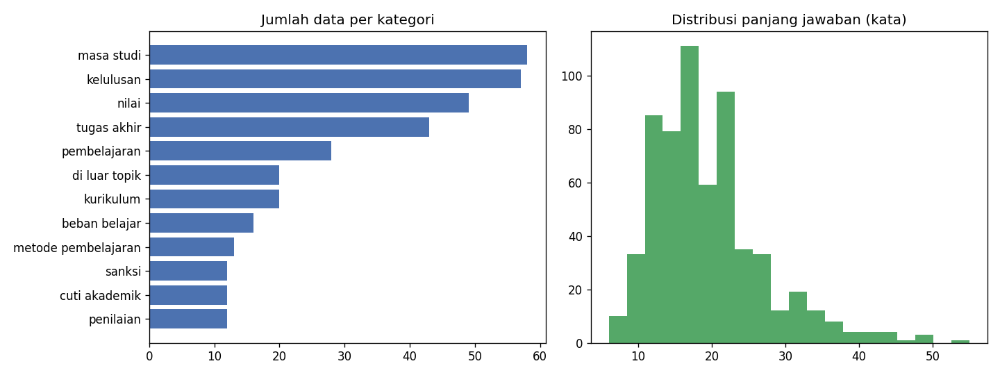

# Analisis Dataset

## Ringkasan preprocessing

| Tahap | Jumlah |
|---|---|
| total baris | 713 |
| dibuang status bukan ok | 106 |
| **data bersih** | **607** |

## Pembagian data

| Split | Jumlah |
|---|---|
| test | 60 |
| val | 60 |
| train | 487 |

## Panjang teks (jumlah kata)

| | min | median | rata-rata | maks |
|---|---|---|---|---|
| pertanyaan | 3 | 9 | 9.2 | 20 |
| jawaban | 6 | 18 | 19.4 | 55 |

## Distribusi kategori

| Kategori | Jumlah | % |
|---|---|---|
| masa studi | 58 | 9.6% |
| kelulusan | 57 | 9.4% |
| nilai | 49 | 8.1% |
| tugas akhir | 43 | 7.1% |
| pembelajaran | 28 | 4.6% |
| di luar topik | 20 | 3.3% |
| kurikulum | 20 | 3.3% |
| beban belajar | 16 | 2.6% |
| metode pembelajaran | 13 | 2.1% |
| sanksi | 12 | 2.0% |
| cuti akademik | 12 | 2.0% |
| penilaian | 12 | 2.0% |
| sks | 10 | 1.6% |
| rekognisi pembelajaran lampau | 9 | 1.5% |
| proses pembelajaran | 9 | 1.5% |
| pengertian pendidikan | 9 | 1.5% |
| krs | 9 | 1.5% |
| di luar pedoman | 8 | 1.3% |
| seleksi mahasiswa baru | 8 | 1.3% |
| pembelajaran bauran | 8 | 1.3% |
| registrasi | 8 | 1.3% |
| struktur manajemen universitas | 8 | 1.3% |
| semester | 7 | 1.2% |
| pindahan | 7 | 1.2% |
| kredit transfer | 6 | 1.0% |
| transfer sks | 5 | 0.8% |
| registrasi akademik | 5 | 0.8% |
| dosen | 4 | 0.7% |
| struktur akademik | 4 | 0.7% |
| kategori | 4 | 0.7% |
| mata kuliah | 4 | 0.7% |
| evaluasi | 3 | 0.5% |
| perwalian | 3 | 0.5% |
| registrasi mata kuliah | 3 | 0.5% |
| pindah kelas | 3 | 0.5% |
| sistem pendidikan | 3 | 0.5% |
| kebebasan akademik | 3 | 0.5% |
| kehadiran | 2 | 0.3% |
| penguatan bahasa inggris | 2 | 0.3% |
| struktur universitas | 2 | 0.3% |
| bahasa inggris | 2 | 0.3% |
| status akademik | 2 | 0.3% |
| penelitian | 2 | 0.3% |
| fasilitas mahasiswa | 2 | 0.3% |
| biaya | 2 | 0.3% |
| magang | 2 | 0.3% |
| program internasional | 2 | 0.3% |
| bahasa pengantar | 2 | 0.3% |
| jenjang pendidikan | 2 | 0.3% |
| alih jenjang | 2 | 0.3% |
| suasana akademik | 2 | 0.3% |
| kapasitas kelas | 2 | 0.3% |
| sidang akademik | 2 | 0.3% |
| glow | 2 | 0.3% |
| mimbar akademik | 2 | 0.3% |
| administrasi | 2 | 0.3% |
| peningkatan bahasa | 2 | 0.3% |
| budaya akademik | 2 | 0.3% |
| pendekatan pembelajaran | 2 | 0.3% |
| capaian pembelajaran | 2 | 0.3% |
| status di luar universitas | 1 | 0.2% |
| jadwal sidang akademik | 1 | 0.2% |
| etika ilmiah | 1 | 0.2% |
| izin | 1 | 0.2% |
| perubahan hasil sidang | 1 | 0.2% |
| kalender akademik | 1 | 0.2% |
| program studi gabungan | 1 | 0.2% |
| standar penilaian | 1 | 0.2% |
| tugas | 1 | 0.2% |
| agenda sidang akademik | 1 | 0.2% |
| peningkatan suasana akademik | 1 | 0.2% |
| peralihan | 1 | 0.2% |
| masalah pribadi | 1 | 0.2% |
| kualitas lulusan | 1 | 0.2% |
| pengumpulan data | 1 | 0.2% |
| persyaratan | 1 | 0.2% |
| sistem akademik | 1 | 0.2% |
| perbaikan | 1 | 0.2% |
| pengertian umum | 1 | 0.2% |
| rencana studi | 1 | 0.2% |
| program studi | 1 | 0.2% |
| kunjungan perusahaan | 1 | 0.2% |
| pembinaan mahasiswa | 1 | 0.2% |
| sarana kampus | 1 | 0.2% |
| perbedaan program | 1 | 0.2% |
| sumber daya akademik | 1 | 0.2% |
| penjaminan mutu | 1 | 0.2% |
| gelar bersama internasional | 1 | 0.2% |
| waktu perkuliahan | 1 | 0.2% |
| pengembangan ilmu pengetahuan | 1 | 0.2% |
| aturan terpisah | 1 | 0.2% |
| mekanisme sidang akademik | 1 | 0.2% |
| ijazah | 1 | 0.2% |
| kuliah umum | 1 | 0.2% |
| tata kelola universitas | 1 | 0.2% |
| internship | 1 | 0.2% |
| prs | 1 | 0.2% |
| ktm | 1 | 0.2% |
| kolaborasi | 1 | 0.2% |
| regulasi mahasiswa | 1 | 0.2% |
| tindak lanjut | 1 | 0.2% |
| interaksi akademik antar mahasiswa | 1 | 0.2% |
| program khusus | 1 | 0.2% |
| interaksi akademik antar dosen | 1 | 0.2% |
| standar akademik | 1 | 0.2% |
| pendidikan internasional | 1 | 0.2% |
| kampus hijau | 1 | 0.2% |
| standar kelulusan | 1 | 0.2% |
| tanggung jawab | 1 | 0.2% |
| interaksi akademik antara civitas akademik dengan eksternal | 1 | 0.2% |
| partisipasi sidang akademik | 1 | 0.2% |
| rekomendasi | 1 | 0.2% |
| tenaga kependidikan | 1 | 0.2% |
| kelas | 1 | 0.2% |
| otonomi keilmuan | 1 | 0.2% |
| kelas internasional | 1 | 0.2% |
| prosedur praktikum | 1 | 0.2% |
| pelanggaran | 1 | 0.2% |
| prasyarat | 1 | 0.2% |
| program pembelajaran jarak jauh | 1 | 0.2% |
| interaksi akademik antara dosen dan mahasiswa | 1 | 0.2% |
| perubahan nilai | 1 | 0.2% |
| transkrip | 1 | 0.2% |
| pengelolaan mahasiswa | 1 | 0.2% |
| standar kompetensi | 1 | 0.2% |
| mekanisme penilaian | 1 | 0.2% |
| proses perbaikan | 1 | 0.2% |
| kriteria kelulusan | 1 | 0.2% |
| akreditasi | 1 | 0.2% |
| pertukaran mahasiswa internasional | 1 | 0.2% |
| gelar ganda internasional | 1 | 0.2% |

